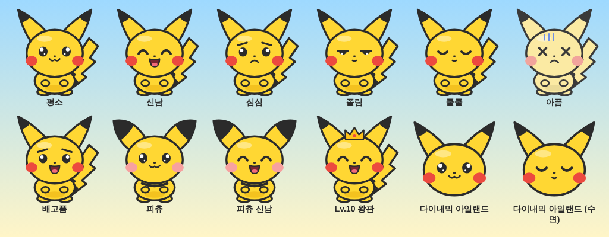

# ⚡ 피카츄 키우기 (iPhone 위젯 + 다이내믹 아일랜드)

홈 화면 위젯, 잠금 화면, **상태바 옆 다이내믹 아일랜드**에서 피카츄를 키우는 다마고치형 iOS 앱입니다.
앱을 열지 않아도 위젯·다이내믹 아일랜드 버튼만 눌러서 밥 주고, 놀아주고, 재울 수 있어요.



> iOS는 서드파티 앱이 상태바에 아이콘을 직접 넣는 걸 허용하지 않습니다.
> 그래서 상태바 바로 옆인 **다이내믹 아일랜드(Live Activity)** 에 피카츄가 상주하도록 만들었어요.
> 다이내믹 아일랜드가 없는 기종은 잠금 화면 배너로 표시됩니다.

## 어디서 보이나요

| 위치 | 내용 |
| --- | --- |
| 다이내믹 아일랜드 (축소) | 왼쪽: 피카츄 얼굴(기분에 따라 표정 변화) · 오른쪽: 배부름 링 (실시간으로 줄어듦) |
| 다이내믹 아일랜드 (길게 누르기) | 피카츄, 대사, 배부름/기분/체력 바, `밥 · 놀기 · 쓰담 · 재우기/청소` 버튼 |
| 잠금 화면 Live Activity | 위와 같은 정보 + 버튼, 밤(자는 중)에는 어두운 테마 |
| 홈 화면 위젯 (소/중/대) | 피카츄 탭 = 쓰다듬기, 버튼으로 바로 돌보기 |
| 잠금 화면 위젯 | 원형(배부름 게이지 + 얼굴), 사각형(레벨·기분·스탯), 시계 위 한 줄 |
| Siri / 단축어 / 액션 버튼 | "피카츄 밥 주기", "피카츄 놀아주기", "피카츄 상태바에 띄워줘" |

## 게임 규칙

- **스탯**: 배부름 🍎 · 기분 💗 · 체력 ⚡ (0–100). 시간이 지나면 줄어들고, 위젯이 15분 간격으로 미리 계산해 보여줘요.
- **행동**
  - 🍎 밥: 배부름 +25 (가끔 나오는 🍅 케첩은 기분 보너스). 배가 꽉 차 있으면 거절해요.
  - ⚡ 놀기: 기분 +20, 체력·배부름 소모. 지쳤거나 배고프면 못 놀아요.
  - 🤚 쓰담: 기분 +6. 위젯/앱에서 피카츄를 탭해도 돼요.
  - 🌙 재우기 / ☀️ 깨우기: 자는 동안 체력이 차고, 다 차면 스스로 일어나요. 덜 자고 깨우면 투정 부려요.
  - 🧹 청소: 시간이 지나면 💩가 쌓여요. 쌓이면 기분이 빨리 떨어지고 4개면 아파요.
- **기분 표정**: 신남 / 평온 / 배고픔 / 졸림 / 심심 / 지저분 / 아픔 / 수면 — 픽셀 표정이 바뀌어요.
- **성장**: 돌볼 때마다 경험치. **Lv.5에 피츄 → 피카츄 진화**, **Lv.10에 왕관 👑**.
- 체력이 바닥나면 알아서 잠들고, 오래 방치해도 죽지 않아요 (아파할 뿐).

## 빌드 방법

필요: Mac, Xcode 15 이상 (16 권장), iOS 17 이상 iPhone, [XcodeGen](https://github.com/yonaskolb/XcodeGen)

```bash
brew install xcodegen
cd pikachu-widget
```

1. `project.yml` 상단에서 두 값을 본인 것으로 바꿉니다.
   - `DEVELOPMENT_TEAM`: Xcode › Settings › Accounts 에서 확인한 Team ID
   - `BUNDLE_ID_PREFIX`: 예) `com.내이름` (App Group 은 `group.<prefix>.pikachupet` 으로 자동 설정)
2. 프로젝트 생성 후 열기
   ```bash
   xcodegen generate
   open PikachuPet.xcodeproj
   ```
3. iPhone 을 연결하고 `PikachuPet` 스킴으로 실행 (⌘R).
4. 앱에서 **다이내믹 아일랜드에 띄우기** 가 켜져 있는지 확인 → 홈으로 나가면 다이내믹 아일랜드에 피카츄가 나타나요.
5. 홈 화면 / 잠금 화면에서 위젯 추가 → "피카츄" 검색.

### 참고

- 다이내믹 아일랜드가 안 보이면: 설정 › 피카츄 › **실시간 현황** 켜기.
- Live Activity 는 iOS 정책상 약 8시간 뒤 자동으로 내려갑니다. 위젯 버튼을 누르거나 앱을 열면 다시 올라와요.
- App Groups 기능이 필요합니다. 무료 Apple ID(개인 팀)로 서명하면 기능 제한이 있거나 7일마다 다시 설치해야 할 수 있어요.
- 피카츄는 Nintendo / Creatures / GAME FREAK 의 캐릭터입니다. 이 프로젝트의 그림은 직접 그린 팬아트이고, **개인 기기 설치용**입니다. App Store 배포는 하지 마세요.

## 구조

```
pikachu-widget/
├── project.yml              # XcodeGen 설정 (앱 + 위젯 익스텐션, App Group)
├── Shared/                  # 앱·위젯 공통
│   ├── PetModel.swift       # 상태, 시간 경과 시뮬레이션, 행동 규칙, 대사
│   ├── PetStore.swift       # App Group UserDefaults 저장소
│   ├── PikachuSprite.swift  # 표정 선택 + 벡터 렌더러
│   ├── PikachuArtData.swift # 피카츄 도형 데이터 (scripts/pikachu_art.py 로 생성)
│   ├── PetViews.swift       # 스탯 바, 말풍선, 배경 등 공통 뷰
│   ├── PetIntents.swift     # 위젯/다이내믹 아일랜드 버튼용 LiveActivityIntent
│   └── PikachuActivity.swift# Live Activity 상태 + 시작/갱신/종료
├── App/                     # 메인 앱 (큰 화면, 이름 짓기, 설정, Siri 단축어)
├── Widget/                  # 홈/잠금 화면 위젯 + 다이내믹 아일랜드 UI
└── scripts/pikachu_art.py   # 그림 원본: 도형 수정 → Swift 데이터 재생성 + HTML 미리보기
```

그림을 고치려면 `scripts/pikachu_art.py` 의 도형을 수정한 뒤:

```bash
python3 scripts/pikachu_art.py preview preview.html   # 모든 표정을 브라우저에서 확인
python3 scripts/pikachu_art.py swift                  # Shared/PikachuArtData.swift 재생성
```

- 위젯은 스스로 코드를 실행할 수 없어서, 저장된 상태에서 앞으로 6시간 동안의 모습을 15분 간격 타임라인으로 미리 계산합니다.
- Live Activity 는 업데이트 사이에 다시 그려지지 않기 때문에, 스탯 바를 `ProgressView(timerInterval:)` 로 그려 시스템이 실시간으로 줄어들게 합니다.
- 모든 버튼은 `CareIntent`(LiveActivityIntent) 하나를 거칩니다. 앱 프로세스에서 실행되므로 상태 저장 → 위젯 새로고침 → 다이내믹 아일랜드 갱신(꺼져 있으면 다시 시작)까지 한 번에 처리돼요.
